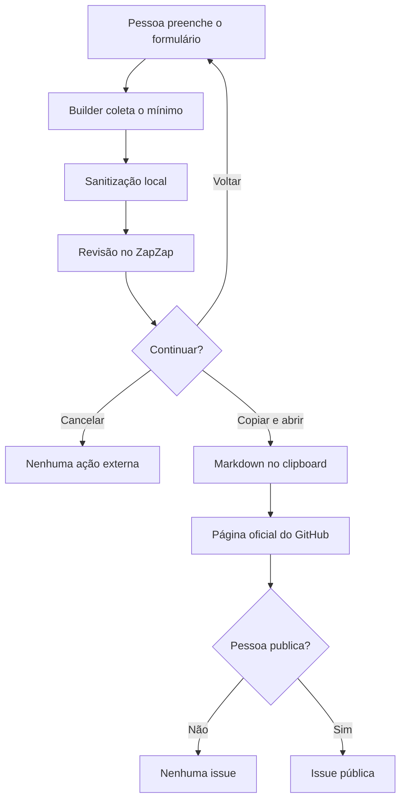
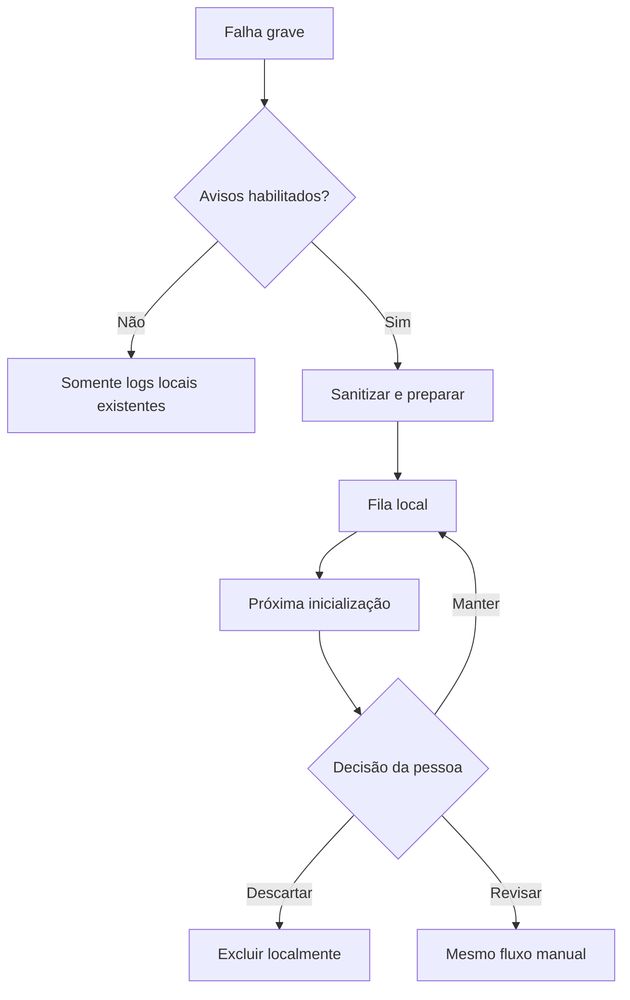

# Relatórios de problemas

O recurso **Relatar problema** prepara localmente um relatório sanitizado para
ser publicado pela própria pessoa no repositório oficial do ZapZap. O
aplicativo não possui cliente de envio, endpoint, credencial do GitHub nem
backend de relatórios. Uma conta GitHub é necessária para publicar a issue.

## Fluxo manual

O formulário solicita categoria, descrição, comportamento esperado e
frequência. IDs estáveis em inglês compõem o documento; rótulos traduzidos
existem apenas na interface. Sistema, erro e logs sanitizados podem ser
removidos antes da revisão. **Revisar relatório** não grava, copia, abre o
navegador nem transmite dados.

Na revisão, o ZapZap mostra um resumo simples e permite abrir o Markdown final
completo. O destino `rafatosta/zapzap`, a visibilidade pública e a necessidade
de conta GitHub ficam explícitos. **Voltar e editar** preserva o formulário.

Somente **Copiar relatório e abrir GitHub** salva o documento localmente, copia
o Markdown para o clipboard e abre a página oficial de nova issue com apenas o
título na query string. Logs, descrições e detalhes técnicos nunca são
colocados na URL. A pessoa cola o conteúdo, pode revisá-lo ou editá-lo novamente
e decide se publica a issue dentro do GitHub.

A tela de revisão informa explicitamente que o corpo não será preenchido pelo
navegador: depois que o GitHub abrir, é necessário colar no campo de descrição
o relatório mantido no clipboard.

## Encerramentos inesperados

Para exceções Python não tratadas, `CrashDumpHandler` continua mantendo os
arquivos técnicos locais existentes e pede a `CrashReportCapture` que monte um
JSON sanitizado somente quando `reporting/crash_prompts` estiver habilitada. A
captura também cobre `threading.excepthook` e não abre UI durante o estado
instável.

Um marcador JSON por sessão removido somente após completar o encerramento
limpo permite que a
próxima execução reconheça também aborts nativos, `SIGKILL` e quedas que não
chegaram ao hook Python. Perda de energia pode aparecer conservadoramente como
encerramento inesperado. Na próxima inicialização, a pessoa pode manter,
descartar ou revisar o relatório; nenhuma dessas ações publica conteúdo.

O ambiente e a fase vêm da sessão anterior; logs são limitados ao último
registro fatal depois do offset salvo. Marcadores legados e logs ausentes,
rotacionados ou truncados ficam sem atribuição; não se publica o histórico como
se fosse um crash novo. O fingerprint v2 usa sinal/componente/frames e uma
segunda assinatura distingue bibliotecas carregadas. Sem assinatura suficiente,
o relatório continua desconhecido e não autoriza deduplicação por causa raiz.
Instrumentação opt-in pode incluir uma cauda sanitizada do trace da sessão que
caiu, sempre no mesmo fluxo de revisão, sem publicação automática.
Detalhes e testes A/B estão em
[webengine-crash-investigation.md](webengine-crash-investigation.md).

## Dados e privacidade

Podem entrar no Markdown, quando selecionados: versão do ZapZap, tipo de
instalação, sistema, arquitetura, desktop/sessão, versões Python/Qt/PyQt,
categoria, relato, tipo/mensagem/traceback do erro e trecho limitado de log.

Nunca entram cookies, headers de autorização, localStorage, sessionStorage,
conteúdo de conversas, contatos, credenciais ou ambiente completo. O
sanitizador mascara e-mails, telefones, IDs de chat, UUIDs, tokens conhecidos,
homes em paths e parâmetros sensíveis de URL. O ZapZap alerta para não escrever
informações pessoais e a pessoa vê o conteúdo completo antes de copiá-lo.

O clipboard passa a conter o relatório apenas depois da ação explícita. O
ZapZap não consegue controlar quanto tempo outro gerenciador de clipboard o
retém; por isso, o histórico local e a revisão continuam usando somente o
documento sanitizado.

## Documento e armazenamento local

`ReportDocument` congela o mapping sanitizado. A prévia completa e o clipboard
são derivados do mesmo objeto por `ReportMarkdownFormatter`, evitando duas
representações independentes. `GitHubReportLauncher` usa uma URL HTTPS fixa do
repositório oficial e adiciona somente o título sanitizado. No Linux, a abertura
chama `xdg-open` diretamente; nas demais plataformas usa a integração Qt. O
navegador padrão do Python permanece como último fallback.

`LocalReportStore` escreve JSON atomicamente no diretório de dados local e
mantém no máximo 20 relatórios por 30 dias. Os estados observáveis são
`pending` (salvo localmente), `pending_review`, `copied` e
`opened_on_github`; o último significa apenas que a página foi aberta, não que
uma issue foi publicada. Não há rede, retry, token, rate limit próprio ou
deduplicação automática. O GitHub permanece responsável pela autenticação e
publicação.

## Testes

`test_reporting.py` cobre sanitização, minimização, Markdown, fila/TTL e captura
local. `test_reporting_ui.py` prova que revisar, voltar e cancelar não abrem o
GitHub; confirma que a ação final copia exatamente o Markdown revisado; e
verifica que somente o título entra na URL. Nenhum teste acessa GitHub real.

A UI `offscreen` não comprova aparência, foco do compositor, integração com o
navegador ou comportamento do gerenciador de clipboard. Antes de publicar,
execute o fluxo completo em sessão gráfica real e confirme login, colagem,
cancelamento no GitHub e URLs longas em cada plataforma mantida.

## Auditoria de diagnóstico — ciclo 7.5.1

A análise das issues foi usada para definir evidências, sem atribuir uma causa
comum nem implementar correções. Exemplos de lacunas: #952 e #956 incluem
múltiplos registros fatais antigos; #975 e #976 associam esse histórico a
sintomas de autenticação e notificações; #977 perdeu horário e versão Chromium
na sanitização. O ciclo anterior já isolava o último fatal por offset/inode no
relatório automático, mas o relatório manual e o ZIP ainda eram ambíguos.

| Referências em `github.com/rafatosta/zapzap/issues/` | Evidência útil e limite |
|---|---|
| #939, #950, #952, #977 | Ambiente da sessão anterior, sinal explícito, fase e frames; marcador sozinho não prova crash nem SIGSEGV. Backtrace nativo e horário observado continuam manuais. |
| #963, #972 | Etapa pedido/seletor/resultado terminal e classe MIME no trace opcional; conclusão do WebEngine não prova integridade do arquivo salvo. |
| #956 | Entrada/aceitação/cancelamento do editor, sem nome, ID ou avatar; aceitação é anterior à persistência e não prova sucesso do salvamento. |
| #284, #974 | Colagem sem formatação e presença de classes MIME conhecidas; Ctrl+V continua nativo e não é interceptado. Comparação com o aplicativo de origem e clipboard real continua manual. |
| #841, #975 | Resultado técnico de carregamento; sucesso não prova login nem presença de QR. Não se consulta nem captura QR, DOM de conversas ou storage. |
| #928 | Resultado de carregamento da página não identifica recursos de figurinhas; tipo de recurso/código de erro ainda exige reprodução assistida sem URL/conteúdo. |
| #876, #914, #961, #968 | Bibliotecas, flags, sessão Qt, GPU/driver visível e mute informado manualmente; codecs, erros de captura/reprodução, dispositivos e xruns não são comprovados por esse inventário. |
| #976 | Bloqueio global/por conta, backend ausente, retorno/exceção do encaminhamento no trace; retorno sem exceção não confirma entrega no desktop nem controle do áudio da página. |

### Contrato de evidência e custo

O documento distingue `failure_scope=current-session-python-exception` (exceção
capturada, sem presumir morte do processo), `previous-session` com
`termination_evidence=fatal-signal` ou `unclean-marker-only`, e logs manuais
`historical-unattributed`. Ambiente permanece em bloco próprio. Últimos eventos
e frames são contexto técnico, nunca causa confirmada. Categoria escolhida pela
pessoa não é classificador automático de falha. Marcadores legados, truncamento
e rotação continuam sem atribuição segura.

Versões numéricas e timestamps ISO validados são preservados como campos
estruturados, sem relaxar o filtro de telefone no texto livre. URLs de texto
são reduzidas à origem: caminho, query e fragmento são removidos. Valores de
flags desconhecidas são ocultados; somente valores técnicos de switches
explicitamente permitidos permanecem. `effective` significa ambiente do
processo preparado pelo SetupManager, não introspecção dos defaults internos
do Chromium nem união de preferências alteradas depois da inicialização.

O relatório distingue a origem host/runtime da identificação do sistema quando
a distribuição real do host não está acessível; inclui kernel e os metadados disponíveis de `/.flatpak-info`:
runtime, commits de aplicação/runtime e permissões shared/sockets/devices.
Não inclui caminhos de permissões de filesystem nem overrides de ambiente.
Commit do pacote Flatpak é um commit OSTree, não o commit Git do fonte. Outros
formatos sem revisão embarcada exigem informar manualmente a revisão exata.
Ausência de GPU no sandbox significa não observada; diretório ICD Vulkan
presente não prova aceleração, driver funcional ou uso pelo Chromium.

O trace existente, habilitado explicitamente com
`ZAPZAP_WEBENGINE_TRACE=1`, recebe operações com vocabulário fixo, horário UTC e
relógio monotônico. Nenhum polling, dependência, alteração de flags ou leitura de
conteúdo foi adicionado. O modo padrão não grava esses eventos. Permanecem os
limites existentes de 4 MiB por segmento e seis arquivos (até 24 MiB), com
cauda de até 16 KB no relatório automático. Traces não têm TTL temporal: a
retenção depende do número de segmentos/sessões e da limpeza manual. O trace
abrange eventos Qt frequentes e deve ser usado apenas numa reprodução curta.
O custo adicional é serialização/escrita síncrona por operação no modo opt-in;
não houve benchmark nem promessa de latência.

ZIPs locais passam a omitir identidade/paths de perfis e User-Agent e a usar
ambiente minimizado e traceback sanitizado. Faulthandler anexado ao ZIP contém
apenas até 16 KB após o offset da inicialização, nunca o histórico inteiro.
Retenção automática limita ZIPs novos a 20/30 dias; ZIPs antigos não são
reescritos para sanitização. O faulthandler bruto local continua necessário para
sinais fatais, limitado na inicialização a um arquivo ativo e um anterior
(rotaciona acima de 1 MiB; um único dump pode ultrapassar esse limiar durante a
execução). A fila JSON conserva 20 relatórios/30 dias. A leitura manual da
cauda agora é limitada em bytes, sem carregar o arquivo inteiro em memória.

### Dados ainda necessários da pessoa

Informe passos, horário com fuso, frequência, instalação/revisão e diferenças
entre ambientes. Para mídia, informe reprodução versus captura/chamada, mute,
codec e stack de áudio quando conhecidos, sem enviar mídia pessoal. Para login,
informe se a página carrega e a interface de autenticação aparece, sem QR.
Para figurinhas, informe se afeta todos os recursos e se o mesmo acontece no
navegador. Captura de rede, dispositivos, codecs e DOM não foi automatizada:
pode revelar dados ou confundir suporte anunciado com funcionamento real.
Backtraces nativos devem seguir o procedimento de investigação e ser revisados
antes de compartilhar. Não há envio automático nem fechamento de issues.
